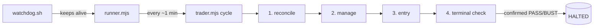

# kraken-spot

Autonomous long-only trading bot for a **Kraken Spot Paper** workspace, driven through the
`kraken` CLI. It plays a funded-challenge game:

| Start | PASS | BUST | Limits |
|---|---|---|---|
| $1000 | equity ≥ $1120 (+12%) | equity ≤ $970 (−3%, static) | no time or daily limit |

> [!WARNING]
> **Paper trading only.** This is an experiment, not financial advice. The strategy has
> **not** shown an edge (see [Results](#results)). Do not adapt it to real money.

## Quick start

Requirements:

- Linux (`flock` and `pgrep`)
- Node.js ≥ 18
- `kraken` CLI on `PATH`, or set `KRAKEN_BIN`

```sh
kraken paper init spotbot --capital 1000   # one-time: funded paper workspace
npm test                                   # offline unit tests (no network, no orders)
npm run cycle:dry                          # one live cycle, entries simulated
touch ENTRY_ENABLED                        # allow new trades (omit = manage-only)
npm start                                  # watchdog + runner, idempotent
npm run status                             # dashboard
npm run validate                           # live consistency check
```

The runbook in [docs/OPERATIONS.md](docs/OPERATIONS.md) covers:

- starting and stopping the bot
- monitoring
- control files
- cron setup
- troubleshooting

## How it works



Each cycle runs four steps:

1. **Reconcile.** Compare `state.json` with the real balances on the exchange.
   - Adopt untracked holdings.
   - Book positions that are gone (for example, the take-profit filled).
   - Fix sizes that don't match.
2. **Manage** each open position. The exits are:
   - a software stop at `entry − 1.5 ATR`
   - a resting limit take-profit at `entry + 0.75 ATR`
   - a 10-day time stop
3. **Entry.** Every pair is screened on its last *completed* daily candle. Every filter
   must pass:

   | Filter | Rule | Reject tag |
   |---|---|---|
   | Market regime | BTC is above its EMA200, and the EMA200 is rising | `regime` |
   | Pair trend | price is above its own EMA200 | `downtrend` |
   | Dip | price is at least `K = 1.25` ATR below EMA20 | `shallow` |
   | Volatility | ATR is at least 3% of price. Quiet pairs get oversized positions, and lost money in testing. | `lowvol` |
   | Fees | target is at least 1.6%. This is implied by the volatility floor and kept as a guard. | `fees` |
   | Cooldown | the pair was not closed earlier the same UTC day | `cooldown` |
   | Correlation | 60-day correlation is at most 0.65 against every held position, including ones opened earlier in the same cycle | `corr:XXX` |
   | Price drift | the live price is within 0.5 ATR of the signal close | `drift` |
   | Capacity | at most 3 positions, and the pair is not already held | `full` |
   | Open-risk budget | total open risk stays within 50% of the cushion | `risk` |

   Candidates are ranked by dip depth, deepest first. The five deepest pairs and their
   reject tags appear in each `bot.log` line as `near=[…]`.

4. **Terminal check.** A PASS or BUST reading must survive a second read 5 s later. Only
   then does the bot flatten all positions, write `HALTED`, and stop for good.

Signals use completed **daily** candles from a 24-pair universe of large-cap coins. The
candles are cached on disk and refreshed once per UTC day.

**Risk** (`riskpolicy.mjs`): the dollar risk per trade (stop distance × size) is tied to
equity.

- It starts at **$0 at the floor** and rises linearly to $7 at $1045.
- From there it rises to $20 at the target.
- It is multiplied by 1.5× from $1015 and by 2× from $1045.
- Since v1.2 everything is multiplied by **×3** (`RISK_MULT`). At $1000 that is about $8
  of risk per trade.
- Total open risk is capped at **50% of the cushion** above the floor (and never above $75).
  For example, at $991 the cap is $10.5. This only limits new entries; open positions are
  never cut.
- Each position's notional is capped at **35% of equity**.

The risk is a fraction of the remaining cushion, so a losing streak on its own can't reach
the floor. The remaining BUST risk is a stop that fills far below its price.

### Safety model

Spot paper has **no native stop orders**, so the runner process *is* the stop.

| Failure | Mitigation |
|---|---|
| Runner dies | The watchdog (single instance via `flock`) restarts it. `kspot`, run from cron, restarts the watchdog. |
| Cycle hangs | Killed after 600 s. After 8 consecutive failures the runner exits and the watchdog restarts it. |
| Cycle killed mid-trade | `state.json` is written atomically after every buy, sell and TP order. The next cycle reconciles. |
| Bogus equity reading | The venue figure is cross-checked against our own mark-to-market valuation. It is rejected if it differs by more than 1% or is flagged incomplete. |
| False PASS/BUST | Requires confirmation by a second read. |
| Restart after game over | `HALTED` blocks the runner, the watchdog and `kspot`. |
| Runner down during a rally | The take-profit rests on the exchange as a limit order. |
| Phone asleep (Android suspends the CPU with the screen off) | On Termux the watchdog holds the wake lock (`termux-wake-lock`). |
| Bad or intermittent signal (the bot runs on a phone) | The network monitor (`net.mjs`) blocks new entries unless the link is healthy, and sends a phone notification on every state change. Open positions are always managed. |
| Losing streak | Entries freeze while the win rate is below 55% over more than 15 strategy exits since v1.2. The freeze clears itself when the win rate recovers. |

## Results

**Live paper run (2026-10-18 → 2026-10-31).** These trades don't measure the strategy:

- Equity was **$994.47** (−0.55%), with 11 closed trades and 1 winner (net −$5.52).
- None of the 11 measures the strategy:
  - 4 were false-BUST liquidations and 2 were cleanups of untracked duplicate buys (bugs
    fixed in v1.1)
  - 3 were manual closes of positions that failed the corrected v1.2 screen (−$0.60 in
    fees and spread)
  - 2 were early trades (1 manual)
- Until v1.2, every signal was computed **one day late**, because a candle filter dropped
  yesterday's completed candle. Entering a day late roughly halves the edge: in the
  2-year event study it fell from +0.26 R to +0.13 R per trade.

**Research summary** (2 years of daily data; details in
[docs/RESEARCH.md](docs/RESEARCH.md)):

| Configuration | Expectancy per trade | PASS / 48 starts | BUST | Median days to PASS |
|---|---|---|---|---|
| v1.1 (×1 risk, 2 positions) | +0.31 R | 0 | 0 | — |
| v1.2 (ATR ≥ 3%, ×3 risk, 3 positions, 35% notional) | +0.43 R | 9 | 0, also with worst-case stop fills | 445 |
| **v1.2.1** (v1.2 + open risk ≤ 50% of cushion) | **+0.43 R** | **4** | **0** | 485 |

Caveats, in order of importance:

1. Every v1.2 PASS starts in the 2025 bull phase. That is a single episode. In the bear
   phase the regime filter keeps the bot flat: 0 PASS, 0 BUST.
2. The ATR floor was found after looking at the data. In practice it removes TRX (and a
   few quiet BTC days), and results fall off a cliff below a 2.75% threshold.
3. With 19 smaller alt pairs added, worst-case stop fills do cause BUSTs.

The cushion cap halves the historical PASSes, because it blocks 2nd and 3rd entries that won
in 2025. It guards against several stops hitting at once, which never happened in the
2-year sample. Run `node sweep_live.mjs eval '{}'` to reproduce the v1.2.1 row
(`'{"CUSHION_FRAC":0}'` for v1.2), or
`BASE=v1 node sweep_live.mjs eval '{}'` for v1.1.

## Configuration

| Env var | Default | Purpose |
|---|---|---|
| `KS_DIR` | repo directory | state, logs and caches |
| `KRAKEN_BIN` | `kraken` | CLI binary |
| `KS_WORKSPACE` | `spotbot` | paper workspace |
| `FBOT_PROTECT` | `off` | any other value enables the break-even stop |
| `KS_NO_CACHE` | — | `1` disables the daily OHLC cache |
| `KS_NOTIFY` | on | `0` disables the Termux phone notifications |
| `KS_WAKELOCK` | on | `0` stops the watchdog from taking the Termux wake lock |

Strategy constants are at the top of `trader.mjs`. The risk ladder is in
`riskpolicy.mjs`. If you change either, re-run `sweep_live.mjs eval` with the
matching overrides first (see docs/RESEARCH.md).

## Files

| File | Purpose |
|---|---|
| `trader.mjs` | one cycle: reconcile → manage → entry → terminal check |
| `runner.mjs` | daemon loop, equity snapshots, failure handling, `HALTED` |
| `ctl.mjs` | CLI wrapper (call stats, network-error classification), rules, equity cross-check, state I/O, dashboard |
| `net.mjs` | connectivity state machine: OK / DEGRADED / INTERMITTENT / OFFLINE |
| `spot.mjs` | buy / sell / limit / cancel, fill parsing |
| `riskpolicy.mjs` | equity-linked risk ladder and ratchet |
| `watchdog.sh`, `kspot`, `killprocs.sh`, `resume.sh` | keep alive / start / stop / post-reboot restore |
| `tests.mjs`, `validate.mjs` | offline unit tests, live consistency check |
| `sweep_live.mjs` | fast challenge simulator mirroring live rules: rolling starts, stop-fill stress, grid search |
| `research/` | the analysis scripts behind docs/RESEARCH.md (event study, robustness, risk sweep, bootstrap) |
| `backtest.mjs`, `fetch_hist.mjs` | historical simulation and its data download |
| `sweep_spot.mjs` | legacy parameter sweep (no EMA200 warm-up, pre-v1 parameters) |
| `scan.mjs`, `fetch_universe.mjs`, `fetch_hist_universe.mjs` | hourly dip scan, universe research |
| `docs/OPERATIONS.md` | runbook |
| `docs/RESEARCH.md` | parameter research: can any configuration reach $1120? |
| `docs/PLAN.md` | original design notes (Spanish, historical) |
