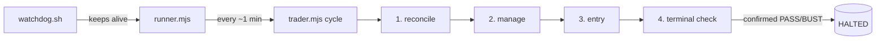

# kraken-spot

Autonomous long-only trading bot for a **Kraken Spot Paper** workspace, driven through the
`kraken` CLI. It plays a funded-challenge game:

| Start | PASS | BUST | Limits |
|---|---|---|---|
| $1000 | equity ≥ $1120 (+12%) | equity ≤ $970 (−3%, static) | no time or daily limit |

> [!WARNING]
> **Paper trading only.** This is an experiment, not financial advice. The strategy has
> **not** shown an edge (see [Results](#results)). Do not adapt it to real money.

## Quick start

Requirements:

- Linux (`flock` and `pgrep`)
- Node.js ≥ 18
- `kraken` CLI on `PATH`, or set `KRAKEN_BIN`

```sh
kraken paper init spotbot --capital 1000   # one-time: funded paper workspace
npm test                                   # offline unit tests (no network, no orders)
npm run cycle:dry                          # one live cycle, entries simulated
touch ENTRY_ENABLED                        # allow new trades (omit = manage-only)
npm start                                  # watchdog + runner, idempotent
npm run status                             # dashboard
npm run validate                           # live consistency check
```

The runbook in [docs/OPERATIONS.md](docs/OPERATIONS.md) covers:

- starting and stopping the bot
- monitoring
- control files
- cron setup
- troubleshooting

## How it works



Each cycle runs four steps:

1. **Reconcile.** Compare `state.json` with the real balances on the exchange.
   - Adopt untracked holdings.
   - Book positions that are gone (for example, the take-profit filled).
   - Fix sizes that don't match.
2. **Manage** each open position. The exits are:
   - a software stop at `entry − 1.5 ATR`
   - a resting limit take-profit at `entry + 0.75 ATR`
   - a 10-day time stop
3. **Entry.** Every filter must pass:

   | Filter | Rule |
   |---|---|
   | Market regime | BTC is above its EMA200, and the EMA200 is rising |
   | Pair trend | price is above its own EMA200 |
   | Dip | price is at least `K = 1.25` ATR below EMA20 |
   | Fees | target is at least 1.6%, which clears the 0.52% round-trip fee |
   | Correlation | at most 0.65 against any held position |
   | Capacity | at most 2 positions, and the pair is not already held |

4. **Terminal check.** A PASS or BUST reading must survive a second read 5 s later. Only
   then does the bot flatten all positions, write `HALTED`, and stop for good.

Signals use completed **daily** candles from a 24-pair universe of large-cap coins. The
candles are cached on disk and refreshed once per UTC day.

**Risk** (`riskpolicy.mjs`): the dollar risk per trade (stop distance × size) is tied to
equity.

- It starts at **$0 at the floor** and rises linearly to $7 at $1045.
- From there it rises to $20 at the target.
- It is multiplied by 1.5× from $1015 and by 2× from $1045.
- Total open risk is capped at **$75**.
- Each position's notional is capped at **20% of equity**.

### Safety model

Spot paper has **no native stop orders**, so the runner process *is* the stop.

| Failure | Mitigation |
|---|---|
| Runner dies | The watchdog (single instance via `flock`) restarts it. `kspot`, run from cron, restarts the watchdog. |
| Cycle hangs | Killed after 600 s. After 8 consecutive failures the runner exits and the watchdog restarts it. |
| Cycle killed mid-trade | `state.json` is written atomically after every buy, sell and TP order. The next cycle reconciles. |
| Bogus equity reading | The venue figure is cross-checked against our own mark-to-market valuation. It is rejected if it differs by more than 1% or is flagged incomplete. |
| False PASS/BUST | Requires confirmation by a second read. |
| Restart after game over | `HALTED` blocks the runner, the watchdog and `kspot`. |
| Runner down during a rally | The take-profit rests on the exchange as a limit order. |
| Losing streak | Entries freeze while the win rate is below 55% over more than 15 trades. The freeze clears itself when the win rate recovers. |

## Results

**Live paper run (2026-10-18 → 2026-10-31)**

- Equity was **$995** (−0.5%).
- There were 8 closed trades and 1 winner, for a net of −$4.93.
- 6 of the 8 trades were forced exits caused by bugs that v1.1 fixed (see the
  [CHANGELOG](CHANGELOG.md)):
  - 4 false-BUST liquidations
  - 2 cleanups of untracked duplicate buys
- The sample is not informative yet.

**Backtest of the live configuration.** This covers 2 years of daily bars, split into
four 180-day blocks:

```sh
K=1.25 TARGET_ATR=0.75 STOP_ATR=1.5 HOLD=10 MIN_TP=1.6 EMA200=1 REGIME=1 node backtest.mjs
```

| Strategy | PASS | BUST | Entries | Win rate | Best block |
|---|---|---|---|---|---|
| dip (live) | 0/4 | 0/4 | 22 | 82% | +1.0% |
| breakout (reference) | 0/4 | 0/4 | 85 | 59% | −0.3% |

The live filters are very selective. Block 1 has no trades at all, because there isn't
enough history yet for the BTC EMA200. The result:

- capital is well protected (the worst equity was $1000)
- trades are rare and small, far from what +12% would need
- reaching PASS would take a looser entry, a larger target or more risk, each validated
  by backtest first

## Configuration

| Env var | Default | Purpose |
|---|---|---|
| `KS_DIR` | repo directory | state, logs and caches |
| `KRAKEN_BIN` | `kraken` | CLI binary |
| `KS_WORKSPACE` | `spotbot` | paper workspace |
| `FBOT_PROTECT` | `off` | any other value enables the break-even stop |
| `KS_NO_CACHE` | — | `1` disables the daily OHLC cache |

Strategy constants are at the top of `trader.mjs`. The risk ladder is in
`riskpolicy.mjs`. If you change either, re-run `backtest.mjs` with the matching
environment variables first.

## Files

| File | Purpose |
|---|---|
| `trader.mjs` | one cycle: reconcile → manage → entry → terminal check |
| `runner.mjs` | daemon loop, equity snapshots, failure handling, `HALTED` |
| `ctl.mjs` | CLI wrapper, rules, equity cross-check, state I/O, dashboard |
| `spot.mjs` | buy / sell / limit / cancel, fill parsing |
| `riskpolicy.mjs` | equity-linked risk ladder and ratchet |
| `watchdog.sh`, `kspot`, `killprocs.sh`, `resume.sh` | keep alive / start / stop / post-reboot restore |
| `tests.mjs`, `validate.mjs` | offline unit tests, live consistency check |
| `backtest.mjs`, `fetch_hist.mjs` | historical simulation and its data download |
| `sweep_spot.mjs` | legacy parameter sweep (no EMA200 warm-up, pre-v1 parameters) |
| `scan.mjs`, `fetch_universe.mjs`, `fetch_hist_universe.mjs` | hourly dip scan, universe research |
| `docs/OPERATIONS.md` | runbook |
| `docs/PLAN.md` | original design notes (Spanish, historical) |
